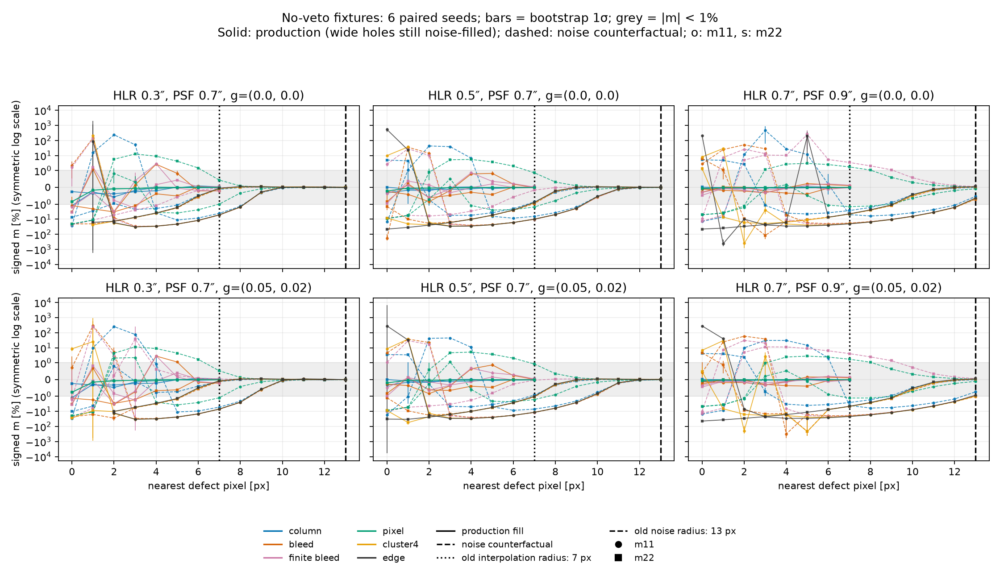

# Conditional single-epoch bias inside the old veto radii

**This scan measures defect-present single-epoch bias, not the catalogue mean or the performance of a replacement rule.**
Its per-case counterexamples do not establish that a fixed veto is necessary.
The [survey-level follow-up](survey_results/report.html) combines real object–epoch prevalence, replacement-rule loss and direct multi-epoch recovery, and supersedes the policy interpretation of this scan.
An interpolated 3-px bleed at 4 px on a 0.3″ galaxy through a round 0.7″ PSF gives **m11 = +2.64 ± 0.25% and c1 = (4.46 ± 0.44) × 10⁻³**.
At 6 px on the 0.7″/0.9″ grid, multiplicative bias passes but **c1 = (6.90 ± 0.33) × 10⁻⁴** exceeds the 5 × 10⁻⁴ bound by 5.7 bootstrap standard deviations.
Noise fill at 10 px reproduces the earlier result: **m11 = −6.50 ± 0.27%, c1 = (−4.68 ± 0.25) × 10⁻³**.

The Napoli decision (16 October 2026) calls for interpolation and adaptive, SExtractor-style exposure-to-tile flags, with flagged objects retained for analysts to cut.
Cail requested removal of the fixed veto on 25 October.
This follow-up makes removal conditional on testing inside the previous radii.
The earlier Napoli interpolated-versus-clean injection comparison retained the veto; its Δm ≈ 0 does not test these newly admitted epochs.
These fixtures establish nonzero conditional bias, not failure of an unconditional catalogue mean, a survey-wide calibration, or the prevalence of that counterexample in data.

## Evidence

- [Full scan table, 696 rows](napoli_veto_scan.csv): distance × geometry × fill × galaxy × PSF, with **both m11/m22 and c1/c2 and their 1σ errors**.
- [Raw measurements](napoli_veto_scan.json): full response and multiplicative matrices, six seed groups and fit S/N, sufficient to recompute the bootstrap errors.
- [Clean controls](napoli_clean_controls.json): six matching galaxy/PSF configurations without a defect.
- [PNG](napoli_veto_scan.png): signed m11 and m22 versus distance for both fills, with the historical 7/13 px radii marked.
  Additive bias is essential to the decision and is reported in the tables even where m passes.



### Distance table for the 3-px bleed, 0.7″ galaxy / round 0.9″ PSF

Each cell is **m11 [%] ± σ; c1 [10⁻³] ± σ**.
These are signed absolute biases, not defect-minus-clean differences.
The full CSV also reports the second axis; this representative slice must not be substituted for the full grid.
A dash means outside the requested interpolation scan, not zero bias.

| Nearest pixel [px] | Interpolation | Noise fill |
| ---: | ---: | ---: |
| 0 | −0.103 ± 0.057; +0.528 ± 0.061 | +2.794 ± 0.575; +111.392 ± 4.026 |
| 1 | −0.177 ± 0.029; +1.391 ± 0.046 | +24.902 ± 1.193; +46.104 ± 5.291 |
| 2 | −0.221 ± 0.041; +1.195 ± 0.028 | +51.536 ± 0.618; −37.525 ± 5.242 |
| 3 | −0.325 ± 0.032; +1.384 ± 0.042 | +28.141 ± 3.695; −83.764 ± 0.942 |
| 4 | −0.033 ± 0.105; +1.510 ± 0.003 | −5.195 ± 1.380; −135.942 ± 55.001 |
| 5 | +0.223 ± 0.047; +1.274 ± 0.044 | −17.385 ± 0.338; −57.545 ± 1.132 |
| 6 | +0.159 ± 0.036; +0.690 ± 0.033 | −20.027 ± 0.117; −40.584 ± 0.951 |
| 7 | +0.103 ± 0.039; +0.246 ± 0.016 | −18.219 ± 0.305; −27.245 ± 0.751 |
| 8 | — | −14.474 ± 0.354; −17.058 ± 0.572 |
| 9 | — | −10.304 ± 0.342; −9.620 ± 0.404 |
| 10 | — | −6.504 ± 0.275; −4.683 ± 0.253 |
| 11 | — | −3.615 ± 0.191; −1.839 ± 0.132 |
| 12 | — | −1.728 ± 0.105; −0.484 ± 0.055 |
| 13 | — | −0.709 ± 0.056; +0.016 ± 0.017 |

## Implemented choice and alternatives

**Production remains unchanged; this single-epoch scan cannot choose the catalogue policy.**
`shape_measurement.central_defect_veto` retains `fixed_radii`, but its rationale now distinguishes conditional fixture targets from catalogue-mean requirements.
The [follow-up report](survey_results/report.html) compares fixed radii, no veto, object-level flag removal, adaptive epoch rejection at k=0/2, and hybrids.
It finds small nominal transported catalogue means for every arm, while their loss and model uncertainty differ.
Adaptive k=0 is recommended for a selected-sample validation run under the stated budget and nearest-fixture transport, not yet implemented as a new default.
The original per-case comparison was insufficient to reject replacements or conclude that an uncut survey mean fails.

PR #973 is stacked on #925, whereas this branch is based on #922 as requested.
Its `defect_flagging` decision is not present here.
Because the veto is unchanged, its description of epochs kept after the central veto remains true and needs no cross-branch edit.
Changing the veto later remains a **campaign-boundary change**, requiring params-pin regeneration in its own commit.
This evidence-only outcome changes neither the pipeline nor its params pins; manufacturing a pin delta would be misleading.

## Measurement and limitations

The scan extends `bias_vs_distance.py`, located through `git log -S EPOCH_INTERPOLATED_DEFECT_RADIUS` and the #922 description.
It uses the same three exponential-galaxy half-light radii / Moffat PSF FWHMs, in arcsec: (0.3, 0.7), (0.5, 0.7), (0.7, 0.9).
Every pair is tested with round PSF reduced shear and with (g1, g2) = (0.05, 0.02).
Stamps are 51 × 51 pixels at 0.1857″/pixel, with known background RMS 10⁻⁴ and high S/N.
The geometries are a column, a full-height 3-px bleed, an 11-row 3-px bleed, an isolated pixel, a 4-column cluster and an edge band.
The first four are interpolated in production and are scanned at every integer distance 0–7 inclusive; their noise-fill counterfactuals span 0–13 inclusive.
The cluster and edge band are noise-filled in production and span 0–13 inclusive.

`defect_response` fits directly through `do_ngmix_metacal` and **bypasses both epoch cuts**, including the 10% masked-fraction cut.
Thus the edge-band measurements are treatment diagnostics, not claims that those epochs would survive production's other cut.
The 4-column cluster occupies only 7.84% of a stamp and can pass that other cut.
No fixed-radius veto is patched out of the scientific fitter because that fitter does not apply the epoch-selection veto.
The current public `defect_fill` option selects each fill explicitly.
The old scan's three-argument monkeypatch no longer matched `interpolated_defects`' four-argument signature; noise rows would otherwise have returned a TypeError rather than measurements.

For each of six seeds (0–5), the helper measures both ±0.02 input shear axes and a two-orientation null pair with detector-frame PSF fixed.
It computes M = inverse(mean Rm) A − I and c = inverse(mean R0) mean e0, retaining the full 2 × 2 matrices rather than using a scalar response.
Errors are the standard deviation of 1,000 paired-seed bootstrap resamples (bootstrap RNG seed 91).
These quantify variation among six high-S/N realizations, not survey shape noise, cosmic variance, or uncertainty from a realistic population.
Clean controls have max |m| = 2.82 × 10⁻⁴ (0.0282%) and max |c| = 9.40 × 10⁻⁶, much smaller than the decisive failures.

**692/696 cases produce estimates.**
Four fail the helper's minimum-singular-value > 0.1 response check: the 0.3″/round-PSF cluster at 0 px, the round-PSF edge at 0 px, and elliptical-PSF edges at 0 and 1 px.
Those rows remain in the CSV with `response_singular_value_le_0.1` and blank numbers; they are neither passing cases nor zero bias.
The singularity diagnosis and clean controls were run in the test allocation after the bundled scan.

Of 168 interpolated fixtures strictly inside 7 px, 79 exceed at least one nominal m/c bound.
That is a fraction of this deliberately structured fixture grid, not a rate for survey objects.
One additional boundary result deserves care: a **counterfactual noise-filled** 3-px bleed at 13 px through the elliptical 0.9″ PSF has m11 = −1.022 ± 0.072%, marginally beyond the nominal 1% bound (0.3σ).
Production interpolates that narrow defect; this does not justify silently enlarging the default radius or claiming that 13 px guarantees every selectable noise-fill case.

## Reproduction and provenance

Run from the checkout root, using a compute allocation:

```bash
OUT_DIR=/scratch/cdaley/veto-reproduction \
  sbatch scripts/validation/masked_pixels/napoli_scan.sbatch
```

The measured scan used job **24999265**, account `def-waerbeke`, 64 CPUs, 96 GiB requested, on c172.
It completed successfully in **2 min 38 s**, using about **14 GiB peak RSS and 2 h 9 min total CPU**.
There was one pool and no sleep/polling loop.
The SIF was `/project/def-mjhudson/cdaley/containers/shapepipe-develop-240b37e4.sif`, loaded with `apptainer/1.4.5`.
Its measured package versions are NumPy 2.5.3, SciPy 1.17.1, GalSim 2.8.5 and ngmix 2.4.1; the workflow helper supplies Snakemake 9.23.1 from the project environment.
The scanner implementation was `bd3ff85b` (the later plotting/documentation edits do not change the measured jobs); the science source and helper match base `b24f92e5` on `origin/feat/masked-pixels`.
The initial tests were committed first as `db9d9c63`, observed failing, then the scanner patch was applied inside the allocation and its tests passed before scanning.
Threaded BLAS/OpenMP were limited to one thread per process.
All work was confined to `/scratch/cdaley/wt-veto` and private evidence directories; no production or other worktree was changed.

The reproducible negative checks inject four failures without editing tracked files:

```bash
# Inside an allocation and the SIF, with PYTHONPATH=src:.
python scripts/validation/masked_pixels/check_veto_mutations.py
```

They remove each veto separately, erase additive bias from the recovery result, and mislabel interpolation as noise fill.
Each must produce exactly one assertion failure; a collection/environment error does not count as a killed mutation.
The 6-px regression records additive bias that an m-only conditional scan misses; it is not itself a catalogue-policy safety check.
Test-suite results and the final decision-record validation are recorded in `napoli_checks.txt`.
