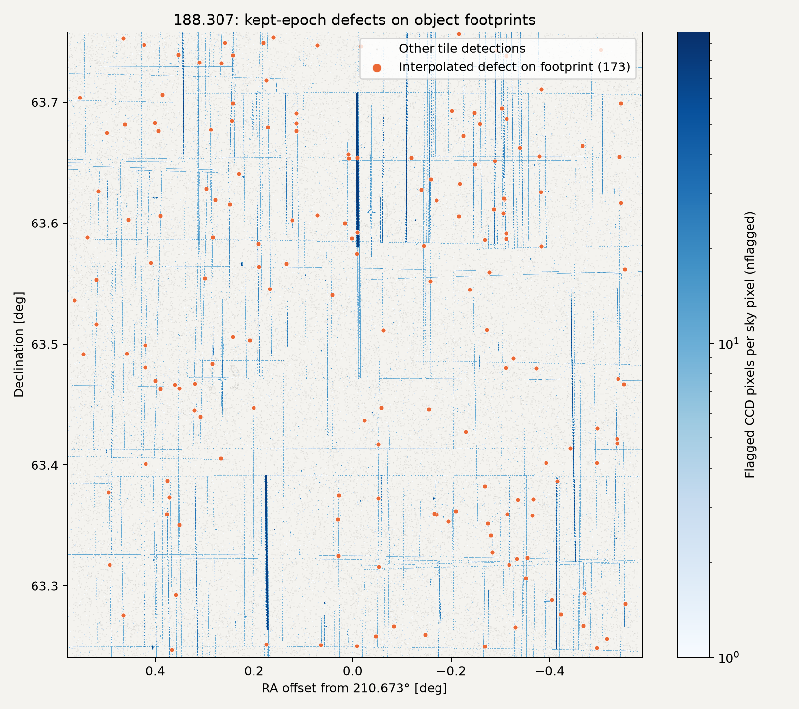

# Tile-object defect flags

We propagate exposure instrument bits onto each tile object's coadd segmentation footprint, using only epochs that pass the masked-fraction cut and central veto.
The implementation does not change fits or impose a catalogue cut.
This change stacks on #925 (`feat/uberseg-seg-vignet`), which puts the int32 `SEG_VIGNET` column in the committed tile catalogue under every blend handling and makes `Tile_cat` read it.
Stacking only on #922 would leave the committed workflow without the footprint input and produce `-1` for fitted objects.

- `NGMIX_IMAFLAGS_ISO` is the bitwise OR of exposure flag pixels on `tile_seg == obj_id`, OR'ed across kept epochs, with every instrument bit preserved.
- `NGMIX_N_EPOCH_INTERP_ISO` counts kept epochs containing at least one interpolated defect pixel on that footprint.
- Both are `-1` when segmentation is missing, the footprint is empty, or it touches a stamp edge.
  We cannot establish completeness in those cases.
  Never-fit final-catalogue rows retain the existing count convention of `0`.
- A zero-weight/off-tile pixel with flag `0` contributes no instrument bit, but contributes to the epoch count if interpolated.
  Clean quarter-turn copies made by defect weighting do not count as defects.

The coadd segmentation is MegaCam-flipped to each exposure's stamp orientation, without reprojection, matching the existing segmentation overlay.
The columns supplement the stamp-wide diagnostics rather than replacing the tile SExtractor's `IMAFLAGS_ISO`.

## Fixture validation

The synthetic path runs `prepare_postage_stamps` with multiple epochs and both flipped and unflipped CCDs.
It checks inside/outside-footprint defects, clean objects, unflagged zero-weight defects, rejected epochs, missing/empty/clipped footprints, safe float-to-integer conversion, integer FITS round trips in every shear extension, and final-catalogue values and never-fit sentinels.

| Mutation | Observed failure | Result |
| --- | --- | --- |
| Reduce/count over the entire stamp | Outside-footprint case becomes `1028 / 2`, expected `0 / 0` | 2 assertion failures |
| Overwrite the OR on each epoch | Final clean epoch erases `1028`, leaving `0` | 2 assertion failures |
| Accumulate before either epoch cut | Rejected epochs contribute bit `64` and interpolation counts | 8 assertion failures |
| Drop the make_cat write mapping | Final-catalogue value stays `0`, expected `1028` | 1 assertion failure |
| Remove the workflow's SEG_VIGNET export | Committed detection disables the footprint | 6 assertion failures |
| Disable SEG_VIGNET in the committed ini | Committed detection disables the footprint | 6 assertion failures |
| Drop Tile_cat's SEG_VIGNET read | Ordinary clean objects receive `-1` instead of `0` | 6 assertion failures |

All seven mutations were restored before running the suite.
`test_committed_detection_supplies_defect_flag_footprint` resolves the actual workflow and ini for data and image simulations under default, noisefill and uberseg handling, then checks the `SEG_VIGNET` load and a clean object's zero-valued diagnostics.
The runtime SIF lacks pytest; validation uses `shapepipe-develop-240b37e4.sif` on Slurm allocations under `def-mjhudson`.
The rebased branch's ngmix, make_cat, unit and PSF property suite passes 830 tests with one skipped; the workflow/DAG/params-pin suite passes 31 tests with one skipped.
The seven mutations were rerun on the rebased branch on allocation `24920131`, with source edits and pytest on the same compute node and bytecode caches cleared between mutations.
The params-pin test runs inside that image with the existing `/project/6001537/cdaley/snakemake-env/lib/python3.12/site-packages` prepended and pytest plugin autoload disabled, because the image lacks Snakemake.
Regeneration leaves the pin unchanged.
`completeness.py` counts files, not columns; this change adds no product file.

## Flag dtype

`split_exp.py` casts flag images to `int16`, and `get_stamps` preserves the input dtype.
On real exposure `2254826p.flag.fits.fz`, CCD HDU 1 is `uint8`, with values `0, 1, 3, 8, 10, 11`; applying the pipeline's split cast and stamp extraction produces `int16` stamps.
The real-tile check below additionally inspects all 112,734 kept flag stamps in newly regenerated SQLite stores: every stamp is `int16`.
The fixture also exercises integral `float32` flag stamps.
The new reduction validates finite, nonnegative, integral, int64-representable values before casting to `int64`, so floats cannot silently truncate or overflow.

## Real-tile validation: 188.307

We regenerated inputs for tile **188.307** from the same campaign as 181.308.
It needs seven exposures rather than nine: `2608415`, `2254827`, `2608414`, `2254828`, `2254835`, `2114047`, and `2114046`.
All 21 raw exposure image/weight/flag files, the tile image and weight, and the external catalogue were already local.
Retrieval used symlinks; nothing was downloaded.
The committed detection exports `SEG_VIGNET`, and the check reads it through `Tile_cat`, without a script-only segmentation fallback.
We ran the real `prepare_postage_stamps` path with `blend_handling=uberseg` and `defect_fill=interpolate`, **without running galaxy fits, tile_ngmix, or make_cat**.
This diagnostic path stops before applying the fit-time defect-weighting scheme.
These are detections presented to epoch preparation, not a shear-selected sample.

### Measured fractions

Of **36,051 objects**, 374 have no kept epoch, 35,056 have a known footprint and kept epochs, and 621 have kept epochs but an edge-clipped footprint.
There are **112,734 kept epochs** out of 120,421 considered: the masked-fraction cut rejects 5,122 and the central veto rejects another 2,565.

| Diagnostic | Count | Denominator | Fraction |
| --- | ---: | ---: | ---: |
| Interpolated defect on the footprint, `NGMIX_N_EPOCH_INTERP_ISO > 0` | 173 | 35,056 known footprints | **0.4935%** |
| Instrument bits on the footprint, `NGMIX_IMAFLAGS_ISO > 0` | 174 | 35,056 known footprints | **0.4963%** |
| Interpolation anywhere in a kept stamp | 12,943 | 35,677 objects with kept epochs | **36.2783%** |
| Unknown footprint, both new columns `-1` | 621 | 35,677 objects with kept epochs | **1.7406%** |
| Footprint touches a stamp edge, before epoch cuts | 633 | 36,051 detections | **1.7558%** |
| Empty footprint | 0 | 36,051 detections | **0%** |

Relative to all detections, the first two rates are 0.4799% and 0.4826%, and the stamp-wide rate is 35.9019%.
All 173 interpolation-positive objects also have instrument bits; one additional object has instrument bits without footprint interpolation.
The diagnostics distinguish flagged pixels from the subset actually interpolated, so those counts need not be identical.
The 1.74% edge-sentinel share is below the proposed few-percent threshold for reconsidering the truncation policy; this tile does not justify changing it.
The script leaves no-kept-epoch array entries at `-1` to distinguish them from measured rows, whereas final-catalogue never-fit rows use `0`.
After that final-catalogue convention, a literal `NGMIX_IMAFLAGS_ISO != 0` would select **795/36,051 (2.2052%)**, including the 621 unknowns; **174** is the count with positive instrument bits.
Consumers must handle the unknown sentinel and fit status explicitly.

| Instrument bit | Objects carrying the bit |
| --- | ---: |
| `1` | 82 |
| `2` | 24 |
| `8` | 96 |

These counts overlap.
The exact positive OR values are `1: 55`, `3: 23`, `8: 92`, `9: 3`, and `11: 1` objects.
No other instrument bits occur on known kept footprints.

### Poisson comparison

The requested independent-pixel reference is the object-averaged `1 - exp(-0.0028 * A * N)`, using footprint area `A` and epoch count `N` for each known footprint.
Here the mean area is **66.77 pixels**, the median is **31 pixels**, and the mean number of kept epochs is **3.160**.
Using each object's values rather than plugging their means into the exponential gives **31.75%**, compared with the measured **0.496%** bit-bearing rate.

The central veto protects compact footprints: **78.22%** of known footprints lie entirely inside its radius, and only **19.12 pixels** lie outside it on average.
Replacing `A` by that outside-veto area lowers the reference to **6.81%**, still well above the measured rate.
The veto is defined on interpolable defects, so this remains an explanatory reference rather than an exact conditional model for instrument bits.
For the same known objects with kept epochs, **6.05%** touch an instrument flag in any candidate epoch before either cut; the corresponding unconditioned reference is **33.00%**.
Thus the disagreement already exists before the cuts, and epoch rejection reduces the observed fraction further.

The 0.28% rate from #887 is an exposure-level DATASEC average, not a local independent probability calibrated for this tile's detected objects.
Bad columns and cosmic rays are spatially correlated, detection is not random with respect to defects, and conditioning on the epoch cuts changes the distribution again.
In the kept stamps here, **0.1448%** of all pixels carry instrument flags, while only **0.01491%** of known-footprint pixels do.
Those measurements and the before/after-cut comparison explain why treating every footprint pixel as an independent 0.28% trial overpredicts the object rate.
We have not measured a separate full-DATASEC rate for these seven exposures, so the relative contributions of local defect density, correlations and detection selection are not isolated.

### Spatial check

Orange points are the 173 interpolation-positive objects; grey points are other detections.
The blue map is `/project/6001537/cdaley/sp-products/smk-g17-int/nflagged_smk-g17-int.hsp`, sampled on the tile at NSIDE 131072.
Its value is **flagged CCD pixels per sky pixel**, summed over exposures, not a count of flagged exposures.
The map shows the expected thin bad-column and other structured defects.
Only **23/173** affected-object centroids land directly in a positive map cell, because the flagged pixel can be displaced from the centroid within the footprint.
Every affected centroid (**173/173**) is within 8 arcsec of a positive map cell, compared with **1,644/2,000 (82.2%)** deterministic sampled controls.
This is a coarse spatial consistency check, not an independent false-positive estimate: the map combines campaign exposures and its any-touch rasterization broadens thin defects.
The grid fraction with any positive map value is 6.97%; the corresponding fraction at other object centroids is 7.36%.

### Reproduction and resource scope

The private run root is `/scratch/cdaley/defectflag-check/run/188307/`.
`config.yaml`, `dryrun.log` and `path-audit.txt` record a **29-job** local Snakemake plan: seven retrievals, seven splits, seven exposure PSF chains and eight tile jobs.
All outputs were audited below `/scratch/cdaley/defectflag-check/` before execution.
We mounted `/project`, `/scratch` and `/home` read-only, then overlaid only that private prefix writable.
Neither production products/run directories nor `feeder/` or `latest/` were modified.

The coadd-weight CLASSIC vignet FITS copy was too slow on shared scratch and was stopped; it is not an input to the diagnostic path.
`EpochSnakefile`, `epoch_vignets.ini`, `epoch-dryrun.log` and `epoch-run.log` record the private one-rule restart of **only the committed MULTI-EPOCH vignetmaker section**, using the completed detection, merged headers, exposure forest and PSF store.
It completed with zero runner errors and **36,051 rows in each of the five epoch stores**.
We did not mark the original full tile-vignet stage complete.
The private completion record verifies the actual five store row counts after the writer exits successfully.

`measure.sh` and `measure-cached.log` record the no-fitting diagnostic command.
`--cache-stores` reads those SQLite stores into RAM without modifying them; exposure WCS objects are decoded once rather than repeatedly per object.
A synthetic end-to-end check verifies identical per-object arrays with and without this cache.
The final targeted pytest rerun was interrupted by the allocation time limit, so it adds no completed-suite result beyond the earlier 830-test and 31-test runs above.
The real measurement, spatial plot and cache-equivalence smoke had already completed.

The single `def-mjhudson` allocation was **24921492**, with 16 CPUs, 40 GiB and a two-hour limit; it has ended, and we also issued `scancel`.
`diskusage_report` showed 398/1024 GiB scratch before and 369/1024 GiB afterward; these are shared, non-transactional quota snapshots rather than the private run's incremental size.
The requested runtime lacks pytest, so we used `/project/6001537/cdaley/containers/shapepipe-develop-240b37e4.sif`.

The measured per-object arrays, original JSON and PNG are `/scratch/cdaley/defectflag-check/188.307.{npz,json,png}`.
The committed [JSON summary](tile_defect_flags_188307.json) preserves the full input paths, counts, denominators and spatial statistics.
Run `bash /scratch/cdaley/defectflag-check/run/188307/measure-exec.sh` in an equivalent allocation to repeat the measurement after changing its job ID, or use the command in `tile_defect_flags.py` with those paths.
`--plot-only --out /scratch/cdaley/defectflag-check/188.307 --nflagged <map> --plot <png>` redraws the figure from existing arrays and refreshes the spatial statistics without rereading the stores.

Back-filling would require retained or regenerated stores, but would not require shear refits.
No back-fill has been attempted.
